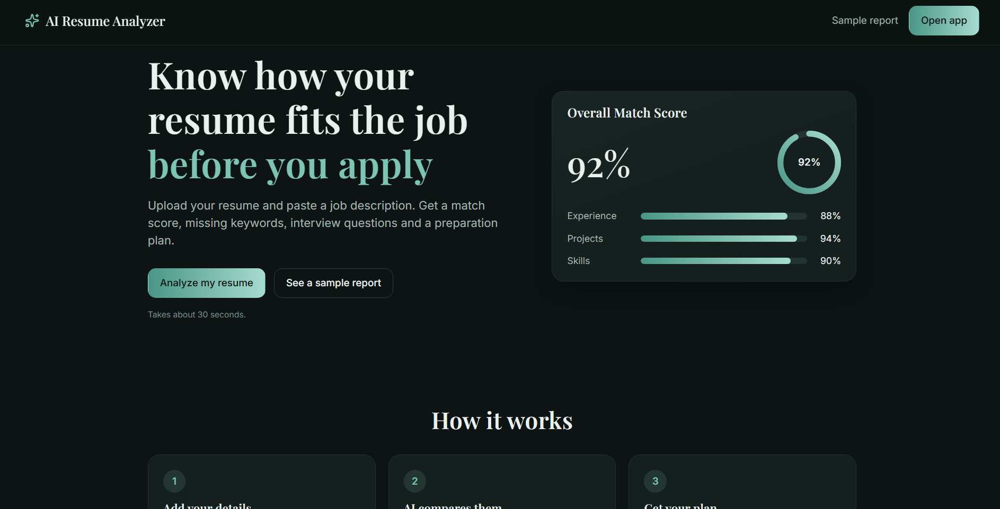
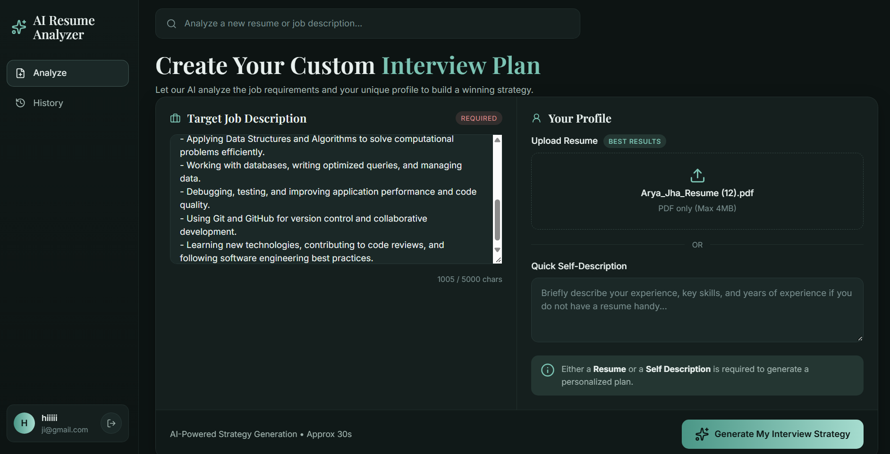
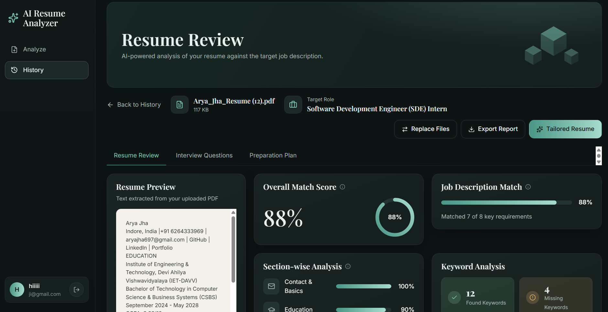
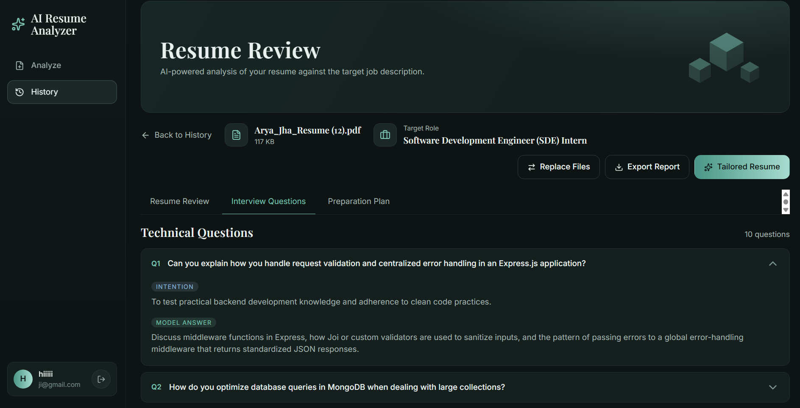
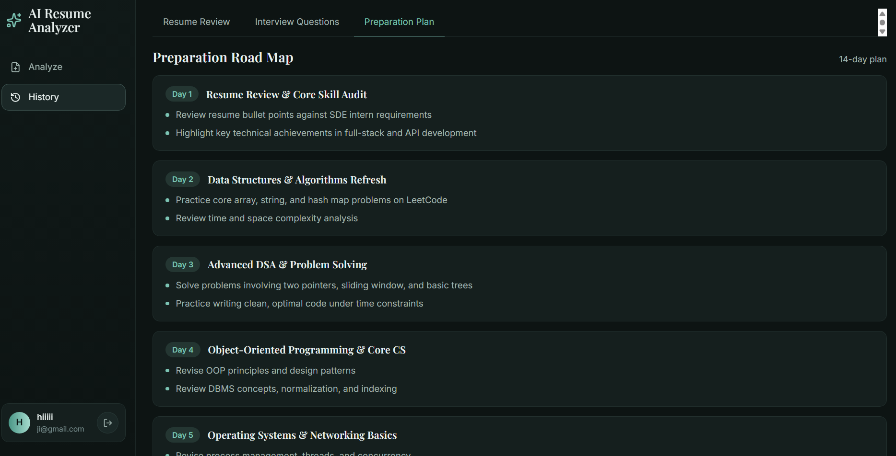
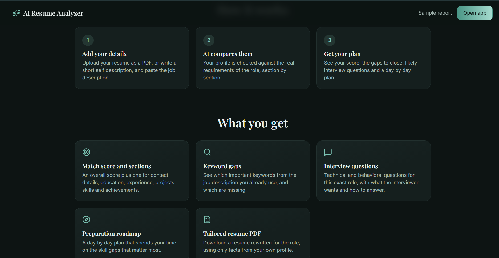
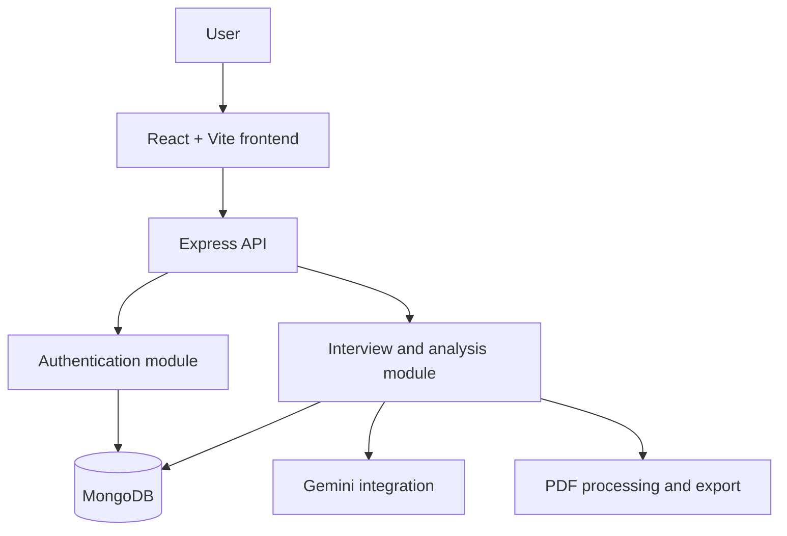

<div align="center">


<a href="https://github.com/Arya-1706/AI-Resume-Analyzer">
  
</a>

<br/>


<!-- Add once you have a deployed link:
[**Live Demo**](https://your-demo-link.vercel.app) · -->
[**Source Code**](https://github.com/Arya-1706/AI-Resume-Analyzer) · [**Screenshots**](#-product-walkthrough) · [**Run Locally**](#-run-locally)

</div>

---

## 💡 The idea

> **Most resumes don't get rejected for lack of talent. They get rejected for lack of *alignment*.**

A resume can look polished and still say nothing a particular job is listening for. A match score alone doesn't help much either: it tells you *where* you landed, not *why*, and definitely not *what to do next*.

**AI Resume Analyzer** closes that loop. Drop in a PDF resume and a job description, and it becomes your prep partner: it reads both, finds the distance between them, and turns that distance into a plan.

| 🎯 Where do I stand? | 🔍 What should I fix? | 🚀 How do I prepare? |
|:---|:---|:---|
| An overall match assessment with a section-by-section breakdown. | Found and missing keywords, skill gaps, and actionable suggestions. | Role-specific interview questions and a personalized prep roadmap. |

---

## 🖼️ Product walkthrough

<table>
  <tr>
    <td width="33%" valign="top">
      <br>
      <p align="center"><b>01 · Landing</b><br><sub>The entry point to the workflow</sub></p>
    </td>
    <td width="33%" valign="top">
      <br>
      <p align="center"><b>02 · Workspace</b><br><sub>Add a JD, upload a resume</sub></p>
    </td>
    <td width="33%" valign="top">
      <br>
      <p align="center"><b>03 · Insights</b><br><sub>Match, strengths, improvement areas</sub></p>
    </td>
  </tr>
  <tr>
    <td width="33%" valign="top">
      <br>
      <p align="center"><b>04 · Interview Qs</b><br><sub>Practice questions for the role</sub></p>
    </td>
    <td width="33%" valign="top">
      <br>
      <p align="center"><b>05 · Roadmap</b><br><sub>Gaps turned into a plan</sub></p>
    </td>
    <td width="33%" valign="top">
      <br>
      <p align="center"><b>06 · Overview</b><br><sub>Workflow and capabilities</sub></p>
    </td>
  </tr>
</table>

---

## ✨ Features

| | Capability | What it does |
|:-:|---|---|
| 📄 | **Resume-to-JD analysis** | Evaluates a PDF resume against a target job description. |
| 📊 | **Match & section insights** | Gives an overall assessment and a breakdown by resume section. |
| 🔑 | **Keyword analysis** | Highlights relevant keywords found and ones that may be missing. |
| 🧩 | **Skill-gap suggestions** | Makes improvement areas easy to spot and act on. |
| 🎤 | **Interview question generation** | Creates role-specific technical and behavioral practice questions. |
| 🗺️ | **Preparation roadmap** | Organizes interview prep into a personalized plan. |
| ✍️ | **Tailored resume** | Generates a role-focused resume version from your profile information. |
| 📥 | **PDF report export** | Download your analysis report. |
| 🕘 | **Report history** | Previously generated reports stay accessible. |
| 🔐 | **Authentication** | Registration, login, and protected application routes. |

---

## 🧰 Tech stack

<table>
  <tr>
    <td align="center" width="140"><b>Frontend</b></td>
    <td align="center" width="110"><br/><sub>React</sub></td>
    <td align="center" width="110"><br/><sub>Vite</sub></td>
    <td align="center" width="110"><br/><sub>React Router</sub></td>
  </tr>
  <tr>
    <td align="center"><b>UI & Styling</b></td>
    <td align="center"><br/><sub>SCSS</sub></td>
    <td align="center"><br/><sub>Lucide</sub></td>
    <td></td>
  </tr>
  <tr>
    <td align="center"><b>Backend</b></td>
    <td align="center"><br/><sub>Node.js</sub></td>
    <td align="center"><br/><sub>Express</sub></td>
    <td></td>
  </tr>
  <tr>
    <td align="center"><b>Database</b></td>
    <td align="center"><br/><sub>MongoDB</sub></td>
    <td></td>
    <td></td>
  </tr>
  <tr>
    <td align="center"><b>AI</b></td>
    <td align="center"><br/><sub>Gemini</sub></td>
    <td></td>
    <td></td>
  </tr>
  <tr>
    <td align="center"><b>Auth</b></td>
    <td align="center"><br/><sub>JWT</sub></td>
    <td></td>
    <td></td>
  </tr>
  <tr>
    <td align="center"><b>Deployment</b></td>
    <td align="center"><br/><sub>Vercel</sub></td>
    <td></td>
    <td></td>
  </tr>
</table>

---

## 🏗️ Architecture

The backend groups functionality into modules; the frontend separates the app shell, feature areas, shared components, and common utilities.



<details>
<summary><b>📁 Repository layout</b></summary>

```text
AI-Resume-Analyzer/
├── backend/
│   ├── scripts/
│   └── src/
│       ├── config/
│       ├── lib/
│       ├── middlewares/
│       ├── modules/
│       │   ├── auth/
│       │   └── interview/
│       │       └── ai/
│       └── utils/
├── frontend/
│   ├── public/
│   └── src/
│       ├── app/
│       ├── features/
│       │   ├── auth/
│       │   ├── interview/
│       │   └── landing/
│       ├── lib/
│       ├── shared/
│       └── styles/
├── docs/
│   └── screenshots/
└── README.md
```

</details>

## 🧠 Engineering decisions

- **Modular backend:** Auth and interview functionality live in separate modules, each with its own routes, controllers, services, models, and validation.
- **Structured AI responses:** AI output is handled through defined schemas, so generated data is checked before the app relies on it.
- **Centralized AI integration:** Gemini access sits behind a dedicated client, which keeps model configuration and fallback behavior easy to manage.
- **Safer document handling:** Resume uploads are validated, and HTML is sanitized before it is used in PDF generation.
- **Request protection:** Rate limiting and request validation protect API endpoints.
- **Centralized authentication flow:** Session restoration runs through a shared auth provider, with protected and guest-only route boundaries.
- **Consistent API handling:** Shared Axios configuration and error-message handling cut down duplicated frontend request logic.

---

## ⚡ Run locally

**Prerequisites:** Node.js 22+, npm, MongoDB (local or a connection string), and a Google Gemini API key.

### 1. Clone the repository

```bash
git clone https://github.com/Arya-1706/AI-Resume-Analyzer.git
cd AI-Resume-Analyzer
```

### 2. Configure and start the backend

```bash
cd backend
npm install
```

Create a local `.env` from the committed example:

```powershell
Copy-Item .env.example .env
```

Set your local MongoDB connection, a strong JWT secret, and your Gemini API key. The example file contains placeholders only.

| Variable | Purpose |
|---|---|
| `NODE_ENV` | Runtime environment |
| `PORT` | Backend server port |
| `MONGO_URI` | MongoDB connection string |
| `JWT_SECRET` | Secret used to sign authentication tokens |
| `CLIENT_URL` | Primary frontend origin |
| `CORS_ORIGINS` | Comma-separated list of allowed frontend origins |
| `GOOGLE_GENAI_API_KEY` | Google Gemini API key |
| `GEMINI_MODELS` | Ordered list of Gemini models to try |

```bash
npm run dev
```

### 3. Install and start the frontend

In a second terminal from the repository root:

```bash
cd frontend
npm install
npm run dev
```

Open the local URL printed by Vite. In development, the frontend talks to the backend through the configured Vite API proxy.

---

## ✅ Validation

```bash
# Frontend production build
cd frontend
npm run build

# Backend resume-sanitizer checks
cd backend
node scripts/check-resume-sanitizer.js
```

Both checks should pass before a change is considered ready to ship.

## 🚀 Deployment

The repository is deployed as two separate Vercel projects:

- **Frontend project:** set `frontend/` as the project root.
- **Backend project:** set `backend/` as the project root.

Configure the production environment variables and the frontend-to-backend API routing for each environment.

## 🔒 Security notes

- Never commit real `.env` files, API keys, database credentials, or production secrets.
- Keep `.env.example` limited to safe placeholders.
- Use a strong, unique JWT secret in production.
- Restrict CORS to trusted frontend origins.
- Keep database credentials and third-party API keys in deployment environment settings.

---

## 👩‍💻 Author

**Arya Jha**

[](https://github.com/Arya-1706)
[](https://www.linkedin.com/in/aryajha17/)

<div align="center">

<br/>

*Built to make resume feedback actionable, from first review to interview prep.*

If this helped you, a ⭐ on the repo means a lot.


</div>
